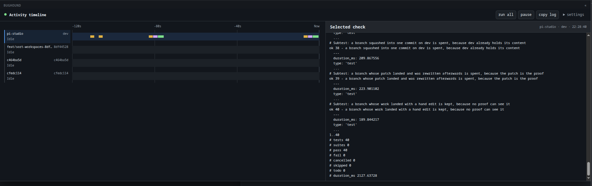

# bughound

An optional pi-studio plugin in Rust that watches a workspace folder for file changes and, when a file
a test covers changes, immediately runs the targeted check for it — pytest for Python, or the type
checker plus node --test for JavaScript and TypeScript, or any command a custom suite names.



A folder is watched for what you configure in its panel: a list of test suites. The suite presets are
`pytest` and `node`; a custom suite names its own command (`pytest tests/test_mod.py::TestDemo` is
exactly the shape that works). No suite is configured to start with, so nothing is read and nothing
runs until you add one — one folder at a time.

It is a plugin like any other: the daemon registers what you tell it, and ships none of it. The plugin
system as a whole — the protocol, the registration, the methods and the panel a plugin can put on a
board — is documented in pi-studio's `docs/plugins.md`.

## What it does

The daemon starts the program, calls `initialize` on it, and from then on the two talk over the same
pipes, one JSON object per line. This plugin:

1. answers the handshake with `{ "protocolVersion": 1, "name": "bughound", "version": … }`;
2. calls `workspace.list` and watches every non-scratch workspace it learns there (told apart by the
   `--workspace` args when it is told any);
3. watches a folder only for the suites the panel configured for it. No suite means no scan, no run, no card;
4. polls a folder it is watching every `--interval-ms` (2000 by default), and when a file a test covers
   changes, waits `--debounce-ms` (500) for the edits to settle and then runs the tests that cover it;
5. resolves a change to its tests by scanning imports — for Python, a test file runs itself, a source
   file runs the tests that import it, a `conftest.py` change runs its folder's tests, and a pytest
   configuration change runs the whole suite. For JavaScript and TypeScript, the same reading over
   `import`, `export` and `require`, plus `tsconfig.json` and `package.json` as the whole-suite
   trigger. The walk is capped at `--max-hops` reverse-import steps (default 2: the changed file
   and its direct importers), so a core file that everything imports pulls a bounded run instead
   of the whole suite. A file nothing covers is reported as such, and no test is spawned for it; a
   custom suite maps a changed source to the tests mentioning its stem, and runs whole when no test
   glob says what its tests are;
6. runs, beside the targeted tests, the folder's type checker — `tsc --noEmit` with the project's
   `tsconfig.json` — when a node suite is configured and one is found, so a type error is worth a run too;
7. keeps one card per workspace holding every problem the last run found, revised on every failing
   run, and taken off the board when a run comes back green.

The plugin keeps the watch and the running on threads of their own, so when the panel asks how it is
going it is answered from shared state at once, even mid-run. The panel is a left drawer, with the
rail's own head, door and buttons: its state, its last run, the pending files, the last log, and the
suite editor the watch is run from.

## Build it

```sh
cd examples/plugins/bughound
cargo build --release
```

The binary lands at `target/release/pi-studio-bughound`, with its panel next to it in
`target/release/assets/` — `build.rs` copies the three panel files there, so the build is the whole
install step. `Cargo.lock` is committed, so the build pins the same `serde_json` this example was
written against.

The version lives in `Cargo.toml` and nowhere else. The handshake reports it from there, and
`plugin.json` — which the daemon reads before the plugin has ever run — carries a copy, because a JSON
manifest has no way to look one up. A release bumps `Cargo.toml` and copies the number into
`plugin.json`; `cargo test` fails if the two ever disagree, so a stale manifest cannot be shipped.

## Register it

This plugin declares itself in the `plugin.json` beside its source. Install it with one command:

```
pi-studio add https://github.com/theMladyPan/bughound.git
```

That clones this repository into `~/.local/state/pi-studio/plugins/bughound/`, builds it with
`cargo build --release`, and leaves it for settings to offer. Open the board's settings, plugins —
it is there, with the drawer panel and the `b` shortcut as its defaults — and enable it in one click.
Nothing starts until you enable it. To update it later, run the same command again: it pulls and
rebuilds, and keeps its registration.

The hand-written way still works: the daemon reads its roster when it starts, from `plugins.json` in
its state folder — by default `~/.local/state/pi-studio/plugins.json`, or `$PI_STUDIO_STATE/plugins.json`
when the daemon was started with its own state folder. Add one row, with the absolute path of the binary
you just built and the panel it carries, in the left drawers:

```json
{
  "plugins": [
    {
      "name": "bughound",
      "command": "/absolute/path/to/the/bughound/target/release/pi-studio-bughound",
      "args": ["--interval-ms", "2000", "--debounce-ms", "500"],
      "visual": {
        "title": "bughound",
        "place": "drawer",
        "entry": "assets/panel.html",
        "files": ["assets/panel.html", "assets/panel.js", "assets/panel.css"]
      }
    }
  ]
}
```

`command` has to be an absolute path to an executable file; a bare name or a relative path is refused
when the roster is read. A plugin that did not start says so in the daemon's log, as
`pi-studio: plugin bughound did not start: …` followed by the reason.

To stop using it, remove the plugin in settings, or take the row out of `plugins.json` and restart the
daemon.

The args, all optional:

- `--interval-ms <n>` — how often the folders are scanned. Minimum 250.
- `--debounce-ms <n>` — how long the edits have to settle before a run.
- `--timeout-s <n>` — a run that does not finish in this time is killed.
- `--max-hops <n>` — how many reverse-import hops past the changed file a change may travel. Default 2: the changed file and its direct importers. Minimum 1. Higher values recover more of a deep chain, at the cost of wider runs on core files.
- `--workspace <id-or-name-or-folder>` — repeatable; watch only these. Without it, every non-scratch
  workspace is watched.
- `--pytest <program>` — the test program. Without it, the plugin runs a project's `.venv/bin/pytest`,
  its venv's `python -m pytest`, or `pytest` on the PATH, in that order.
- `--pytest-arg <arg>` — repeatable; fixed flags before pytest's own.
- `--node <program>` — the Node program the JavaScript tests run with. Without it, `node` on the PATH.
- `--tsc <program>` — the type checker. Without it, the project's `node_modules/.bin/tsc`, then `tsc`
  on the PATH; with no `tsconfig.json` or no `tsc` anywhere, there is no typecheck, never an error.
- `--watch <python|javascript>` — repeatable; the preset suite to switch on for every folder this
  plugin watches. It is the same suite the panel's editor sets, for a registration written by hand or
  a folder no panel was opened on. Without it, and until a suite is added in the panel, a folder is
  watched for nothing.

The panel's settings carry, per repository, a list of test suites, editable by hand in the same
`bughound.json` if you prefer JSON. Every worktree folder of one repo shares one entry, since each
worktree is a checkout of the same code. A suite is one of two presets or a custom command:

- `preset: "pytest"` maps changed files through the Python import graph and runs the resolved files
  with the pytest binary and its flags. `preset: "node"` does the same over `import`, `export` and
  `require`, running `node --test`, and adds the TypeScript type check when `tsc` is found.
- `preset: "command"` runs your own argv: `run` and `fullRun` are templates whose `{targets}`
  becomes the resolved test files (without it, they are appended). A changed test file runs itself;
  a changed source runs the tests whose bodies mention its file stem; with no `testGlobs` there is
  nothing to search, and the command runs whole. `pytest tests/test_mod.py::TestExample` fits this
  shape exactly.
- Every suite shares `testGlobs` (defaults to the preset's own test pattern), `watchGlobs`
  (command suites only; empty watches everything not pruned), `configFiles` (changes that mean a
  whole-suite run when `fullOnConfigChange` is on), `run` and `fullRun`. Full examples live in
  `examples/settings-python.json`, `examples/settings-node.json` and
  `examples/settings-custom.json`; legacy files with the old `watch` switches are read as those
  two presets and rewritten as suites on the next save.

## Check it

```sh
cargo test                                              # the plugin's own tests, no pipes involved
BUGHOUND_BIN=$PWD/target/release/pi-studio-bughound \
  node --test check/against-host.mjs                     # the real PluginHost, a fake pytest
BUGHOUND_BIN=$PWD/target/release/pi-studio-bughound \
  node --test check/against-service.mjs                  # the real roster, service and board
```

`against-host.mjs` watches a throwaway Python and TypeScript project through the real `PluginHost`
and asserts that editing a source file runs the test that imports it, that a failing run is reported
by node id, and that a TypeScript failure cards and then un-cards on healing.
`against-service.mjs` registers the plugin the way the daemon does, with its panel placed in the
drawers, and asserts that a failing run leaves the one card, and a later green run takes it back.
Both run against fake `pytest`, `node` and `tsc` scripts, so no Python environment is needed and no
real Node project is required to check either.

## What it is not

This is not a sandbox or a template for reading anything you like. A plugin runs as you, with an
allowlisted environment, and it can do whatever your user can do; what the daemon offers it is the
nine methods in `server/plugins/service.ts`, and this example uses three of them (`workspace.list`,
and `cards.note` with its `cards.remove` pairing). Dynamic imports, data files and C extensions are
invisible to a static reading of imports, so a change to one of those reports that no tests cover it
rather than guessing — the panel's run-all runs the whole suite regardless. A command suite with
no `watchGlobs` watches every file not pruned; edits to a README then run its command whole, so
declare the globs you mean. Templates expand only whole-token `{targets}`, never a substring of a
flag; write `--rootdir {targets}` as its own word instead.

A custom suite's `run` and `fullRun` name the program and argv bughound spawns on your behalf,
selected from this plugin's own settings and panel only, never from the board. Still, a settings
file is executable by extension: anyone who can write `bughound.json` in a board folder can make the
next file change run their program as you. Keep the settings file in state you trust.

One version note: the settings shapes `watch` and `set_watch` were replaced outright by `suites`
and `set_suites` in the same commit, and the panel and the plugin always ship together in this
repository, so an older panel will talk to a newer plugin only to be refused. The settings file
itself migrates on the next save; keep a copy before downgrading the plugin.

One trust decision is called out rather than hidden: with no `--pytest`, the plugin runs the watched
folder's own `.venv/bin/pytest` (or its venv's `python -m pytest`) when it finds one, and that binary
runs with your privileges on every change, as it would if you ran pytest there yourself. A folder you
would not run a command out of should be left unwatched; `--pytest` names the program instead.
